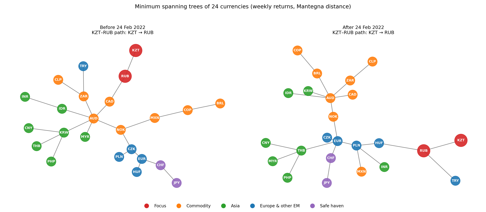
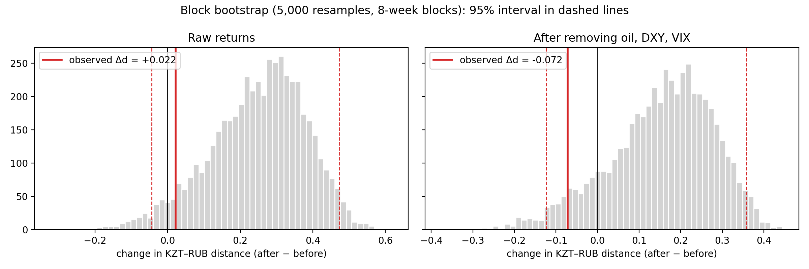

README with results
# Tenge and Ruble in the Emerging-Market Currency Network, 2015–2026

*Independent research project (ongoing) · Sara Tyulyuova · Almaty, Kazakhstan · 2026*

## Question
How did the network position of the Kazakhstani tenge relative to the Russian ruble change after
24 February 2022? I test whether the correlation-based distance between the two currencies changed,
inside a network of 24 currencies and after controlling for oil, the US dollar and global risk.

## Key findings
- **The link survived the 2022 shock.** The ruble is the tenge's nearest neighbour in the minimum
  spanning tree both before and after February 2022. Their correlation changed only slightly
  (0.42 → 0.39).
- **No statistically significant change.** Block bootstrap (5,000 resamples, 8-week blocks):
  raw returns Δd = +0.022, 95% CI [−0.044, +0.473]; after removing oil, DXY and VIX
  Δd = −0.072, 95% CI [−0.123, +0.358]. Both intervals contain zero.
- **What did change is the ruble's position.** Its neighbours moved from the Canadian dollar
  (commodity currencies) to the Hungarian forint and Turkish lira (emerging Europe), and its
  betweenness centrality doubled (0.087 → 0.170).
- **Data finding.** Yahoo Finance and official Bank of Russia ruble rates agree before 2022
  (weekly-return correlation 0.96 after date alignment) but diverge after (0.89), consistent with
  the fragmentation of the ruble market under sanctions.

## Data
- Weekly (Wednesday-to-Wednesday) log returns of 24 currencies, Sep 2015 – Sep 2026 (~578 weeks).
  The start follows the tenge's move to a free float on 20 Aug 2015.
- KZT and RUB: official rates of the National Bank of Kazakhstan and the Bank of Russia
  (verified against Yahoo Finance); other currencies, gold and factors: Yahoo Finance.
- External factors: Brent oil, US dollar index (DXY), VIX.
- Cleaning: one-day spikes that reverse the next day were treated as data errors.
  KGS (no data) and UZS (not market-determined before 2017) were excluded.
  Details: [data/SOURCES.md](data/SOURCES.md).

## Methods
1. Correlation-based distance d = √(2(1 − ρ)) (Mantegna, 1999), a proper metric.
2. Minimum spanning trees (Kruskal's algorithm) before and after 24 Feb 2022; centrality measures.
3. OLS regression of each currency on oil, DXY and VIX; the test is repeated on the residuals,
   so that common shocks do not create a spurious link.
4. Moving-block bootstrap for the change in distance. Blocks keep runs of calm and crisis weeks
   together, because currency returns are not independent over time (volatility clusters).

## Limitations
- Correlation is not causation: results describe co-movement, not its causes.
- The KZT–RUB correlation is driven by a few extreme weeks (KZT excess kurtosis ≈ 17), so bootstrap
  intervals are skewed; conclusions rely on confidence intervals rather than p-values.
- Official KZT/RUB rates are daytime fixings; other currencies are Yahoo closing rates.
- Central-bank interventions, capital controls and trade flows are not modelled.

## Next steps
- Robustness: excluding the Feb–Apr 2022 shock, other block lengths, all-Yahoo data.
- Rolling-window dynamics of the tenge–ruble distance.
- Partial-correlation networks and gold as an alternative numeraire.

## Repository
| File | Content |
|---|---|
| `analysis.ipynb` | Main analysis: trees, factor regressions, bootstrap test |
| `network_analysis.ipynb` | Data download, cleaning and verification against official rates |
| `data/` | Data and sources |
| `figures/` | Figures and result tables |
| `notes.md` | Research log |

## References
- Mantegna, R. N. (1999). Hierarchical structure in financial markets. *European Physical Journal B*, 11, 193–197.
- Andrzejak, J., et al. (2024). *Entropy*, 26(4), 279.
- Landmesser-Rusek, J., & Andrzejak, J. (2024). *Optimum. Economic Studies*.
- Yu, W. (2025). *Post-Communist Economies*, 37(3), 223–246.
